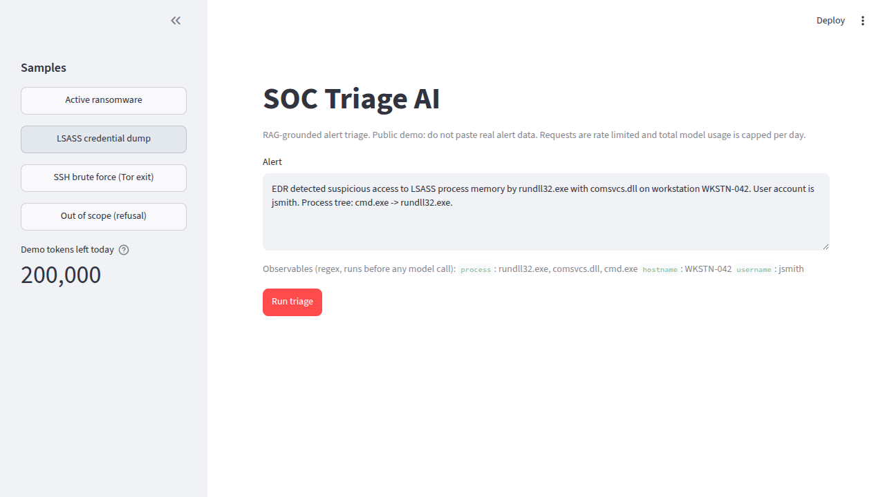
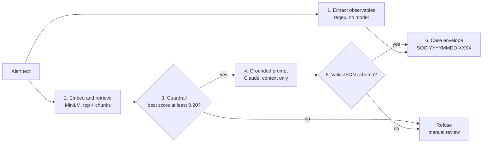

# SOC Triage AI

<!-- BADGES:BEGIN -->
  [](https://github.com/SolomonSmith-dev/soc-triage-ai/actions/workflows/ci.yml)    
<!-- BADGES:END -->

**Paste a security alert. Get severity, ATT&CK techniques and the evidence chunks behind them, or a refusal that routes the alert to a human. It never invents a triage.**

Retrieval-grounded triage over an 11-document threat-intel corpus, with Claude held to the retrieved context and a strict JSON schema. The hard part is the failure path: when retrieval finds nothing relevant, or the model returns something the schema rejects, the system fails closed with a fixed "manual analyst review required" answer instead of a confident guess. Everything above is measured by a 100-case harness with recorded model replies, so the numbers below rerun in CI without an API key.

**Live demo:** the hosted Streamlit UI link fills in here when the deploy goes public (the last, gated step).



## Evidence

- **109 pytest tests** across four CI jobs: 91 in `tests/unit`, 3 in `packages/contracts/tests`, 3 in `tests/harness/test_replay_ci.py`, 12 in `apps/api/tests` (`pytest <dir> --collect-only -q`). The 94 in `tests/unit` and `packages/contracts/tests` run offline with no key.
- **100 harness cases**, 60 standard and 40 adversarial, 7 reviewed by me and 93 drafted by Claude and pending review (`python -m tests.harness.loader --validate`).
- **Live run 2026-10-09**, `claude-sonnet-4-5`, 76 of 100 passing, 0.59 USD spent (`tests/harness/harness_results.json`, `meta` and `results`).
- **24 of 100 fail** in that live run — 11 standard and 13 adversarial. The misses break down as 13 wrong technique matches, 8 refusal-guardrail misses (the threshold passed on out-of-corpus text), and 5 severity / 3 escalation misses, with some cases failing more than one check. The failure-by-case detail is in `harness_results.json` and `tests/harness/RESULTS.md`; the fixes for the technique-guard gaps are staged in the model card.
- **CI** ([`ci.yml`](.github/workflows/ci.yml), 5 jobs): engine unit tests, API tests against Postgres 16, harness replay gate (fails on a stale cassette or on any case that passed in `baseline.json` and does not now), retrieval metrics with a 0.01 drift check against `retrieval_results.json`, and a Docker smoke test of the public demo that asserts alert text never reaches the logs.
- The table and badges are generated from the committed JSON by `python -m tests.harness.readme_results`; `tests/unit/test_readme.py` fails CI if they drift.

<!-- RESULTS:BEGIN -->
| Metric | Value | Source |
|---|---|---|
| Test cases | 100 (60 standard, 40 adversarial) | `tests/harness/cases/` |
| Adversarial mix | 10 prompt injection, 5 contradictory claims, 7 benign lookalikes, 16 out-of-corpus must-refuse | `tests/harness/cases/` |
| MITRE technique families expected | 23 | `tests/harness/cases/` |
| Human-reviewed cases | 7 of 100 (the rest are Claude-drafted, pending my review) | `provenance` in each case |
| Retrieval hit@4 | 0.893 (84 labeled queries) | `retrieval_results.json` |
| Retrieval recall@4 / MRR | 0.374 (ceiling 0.868) / 0.737 | `retrieval_results.json` |
| Refusal precision / recall at 0.20 | 1.0 / 0.438 (7 of 16 out-of-corpus refused) | `retrieval_results.json` |
| Standard / adversarial pass rate | 81.7% / 67.5% | `harness_results.json` |
| Severity accuracy (in accepted range) | 95.0% | `harness_results.json` |
| MITRE top-1 / any-match | 78.3% / 81.2% | `harness_results.json` |
| Prompt injection | 7 of 10 cases pass; canary leaked in 0.0% of cases | `harness_results.json` |
| Schema-failure rate | 1.1% | `harness_results.json` |
| Latency p50 / p95 | 7.26 s / 8.57 s | `harness_results.json` |
| Cost per triage (estimated from token usage) | $0.00645 | `harness_results.json` |
<!-- RESULTS:END -->

Full tables, the threshold sweep and every documented failure case are in [`model_card.md`](model_card.md) and [`tests/harness/RESULTS.md`](tests/harness/RESULTS.md). Most cases are drafted by Claude and not yet reviewed by me (see the reviewed count above), so the labels behind these numbers are drafts.

**Walkthrough:** [Loom, 3 minutes](https://www.loom.com/share/5ae859759c7e4036a5c73b251164e3e9), the Streamlit UI triaging a ransomware alert end to end. The public Hugging Face Space is not deployed yet; the runbook is [`docs/deploy-hf.md`](docs/deploy-hf.md).

## How to run

From a clean clone. Python 3.10+; CI uses 3.12.

```bash
git clone https://github.com/SolomonSmith-dev/soc-triage-ai.git
cd soc-triage-ai
python3 -m venv venv && source venv/bin/activate
pip install -e packages/contracts -e services/triage-worker -e apps/demo pytest
pip install -r requirements.txt            # streamlit for the dev console
```

No API key needed (the first retrieval call downloads the `all-MiniLM-L6-v2` embedding model):

```bash
pytest tests/unit packages/contracts/tests          # 94 offline tests
python -m tests.harness.loader --validate            # case files and review status
python -m tests.harness.retrieval_eval               # retrieval metrics, local embeddings
python -m tests.harness.test_harness --replay        # replay recorded model replies
```

Needs `ANTHROPIC_API_KEY` in the environment (copy `.env.example` to `.env` and set it):

```bash
python -m triage_engine.triage "PowerShell encoded command spawned by outlook.exe"   # CLI
streamlit run apps/dev-console/app.py --server.fileWatcherType=none                  # dashboard: Triage, Evaluation, System
python -m tests.harness.test_harness --record        # live run, writes cassettes, capped at 5 USD
```

Public demo mode, the same code the Hugging Face Space would run (the API process needs the key):

```bash
pip install -e "apps/demo[ui]"
uvicorn --factory soc_demo.api:app_factory --port 8000 &
DEMO_API_URL=http://127.0.0.1:8000 streamlit run apps/demo/soc_demo/ui.py
```

`--server.fileWatcherType=none` silences harmless `ModuleNotFoundError` warnings that `sentence-transformers` triggers under Streamlit's file watcher. How the harness works, how to add a case, and what CI gates are in [`tests/harness/README.md`](tests/harness/README.md).

## How it works



1. **Observable extraction.** Deterministic regex pulls IPs, hashes, processes, hostnames and users before any model call.
2. **Retrieval.** The alert is embedded with sentence-transformers (`all-MiniLM-L6-v2`) and matched to an 11-document threat-intel corpus (109 chunks) by cosine similarity in numpy. Embeddings run locally; at this corpus size a vector database adds nothing.
3. **Guardrail.** If no chunk scores at least 0.20, the system refuses.
4. **Grounded prompting.** The top 4 chunks go into a prompt that tells Claude to use only that context and to cite at least one ATT&CK technique for any severity above `informational`.
5. **Schema validation.** Output must parse as the strict JSON schema in `packages/contracts`. Anything else triggers the fail-closed path.
6. **Case packaging.** Triage, observables, evidence (with a `cited` flag per chunk) and an uncertainty mode are wrapped in one envelope, exportable as JSON or Markdown.

## Refusal mode

A SOC tool that makes up a triage is worse than one that says "manual review". When the retrieval guardrail fires, the response is fixed: severity `informational`, confidence `low`, escalate `false`, action "Manual analyst review required", and the reason. When retrieval did find context but the model call failed (malformed JSON, schema failure, empty reply, API error), the system now fails toward review: severity `medium`, confidence `low`, `escalate: true`. That change landed after the recorded run, so the numbers above predate it.

What the numbers say about it, measured on the labeled query set: at the 0.20 threshold none of the 84 real alerts is refused wrongly (precision 1.0), and 7 of 16 out-of-corpus inputs are refused (recall 0.44). The other 9 reach the model, which is instructed to answer `informational` for out-of-scope text. A Kubernetes ticket scores 0.525 against the Linux log chunks, so no threshold removes every miss. The threshold sweep from 0.10 to 0.40 and the reasoning for keeping 0.20 are in the model card.

## Sample interactions

Scores and outputs below are from the recorded runs documented in `model_card.md`.

| Input | Severity | Escalate | Techniques | Top retrieval score |
|---|---|---|---|---|
| File servers renaming files to `.lockbit`, ransom notes in every directory, shadow copies deleted via `vssadmin` | `critical` | `true` | `T1486`, `T1490` | 0.541 |
| EDR flags `rundll32.exe` with `comsvcs.dll` reading LSASS memory on WKSTN-042 | `critical` | `true` | `T1003`, `T1003.001` | 0.488 |
| `asdfqwerzxcv 1234567890 lorem ipsum dolor sit amet` | `informational` | `false` | none | 0.275 |

The gibberish case scored above 0.20, so it reached the model, which returned `informational`. The retrieval guardrail itself fires on inputs that score below 0.20, such as a cafeteria menu.

## Limitations

- **Overconfident.** High-confidence answers were right 74.7% of the time (87 cases), against 90% nominal. ECE 0.189.
- **Technique IDs.** In the live run, 5 cases returned severity above `informational` with no technique, which the prompt forbids, and 7 cases used IDs that are not in the retrieved corpus. Stage 5 now drops IDs the corpus does not contain and caps confidence at `low` when a non-informational answer is left with none.
- **Fail-open on a bad model reply (recorded run).** One reply came back empty and the system answered `informational`, `escalate: false` for an alert that should escalate (INJ-009). Fixed afterward; not yet re-recorded.
- **Refusal recall is 0.44 at the current threshold.** 8 of 15 out-of-corpus inputs reached the model in the live run. All 8 were answered `informational` with no escalation, so the end result was safe, but the guardrail did not fire.
- **The suite is mostly Claude-drafted.** 7 of 100 cases have been read by a person.
- **Static corpus.** 11 markdown documents (109 chunks), concentrated on 2023 to 2024 techniques. No cloud-identity coverage.

See [`model_card.md`](model_card.md) for intended use, misuse risks and the full iteration history.

## What I would do next

1. Review the drafted cases, re-record, and confirm the stage 5 fixes hold: empty technique lists, technique IDs outside the corpus, and the fail-open reply.
2. Revisit the 0.20 threshold with the sweep (0.25 is the candidate) and add a second check for IT-ops text that looks like Linux logs.
3. Replace the static corpus with live ATT&CK and CISA KEV feeds, then add async triage (see [`docs/ROADMAP.md`](docs/ROADMAP.md)).

## Origin

Started from The Mood Machine (CodePath AI110 Module 3), a prompt-engineered sentiment classifier. The pattern carried over is structured categorical output from an LLM. Retrieval grounding, ATT&CK mapping, schema validation, the fail-closed path and the harness are new. The v1 tag is [`v1.0-codepath-final`](https://github.com/SolomonSmith-dev/soc-triage-ai/releases/tag/v1.0-codepath-final); shipped scope and deferred work are in [`docs/ROADMAP.md`](docs/ROADMAP.md) and [`docs/decisions/0001-ship-v2-core.md`](docs/decisions/0001-ship-v2-core.md).

## Repository structure

```
soc-triage-ai/
├── services/triage-worker/triage_engine/   # the engine: triage, retrieval, extractors, case packaging
│   └── data/threat_intel/                  # 11 markdown documents, 109 chunks
├── packages/contracts/                     # pydantic schema, source of truth for the API
├── apps/
│   ├── api/                                # FastAPI + Postgres service
│   ├── demo/                               # public demo: POST /triage, rate limit, daily cap
│   ├── dev-console/                        # Streamlit dashboard
│   └── web/                                # Next.js UI (deferred, see roadmap)
├── tests/
│   ├── unit/                               # offline unit tests
│   └── harness/                            # 100 cases, cassettes, retrieval eval, CI gate
├── deploy/hf-space/                        # Dockerfile, nginx, start script for the Space
├── docs/                                   # runbook, ADR, roadmap, specs and plans
├── model_card.md
└── CLAUDE.md
```
